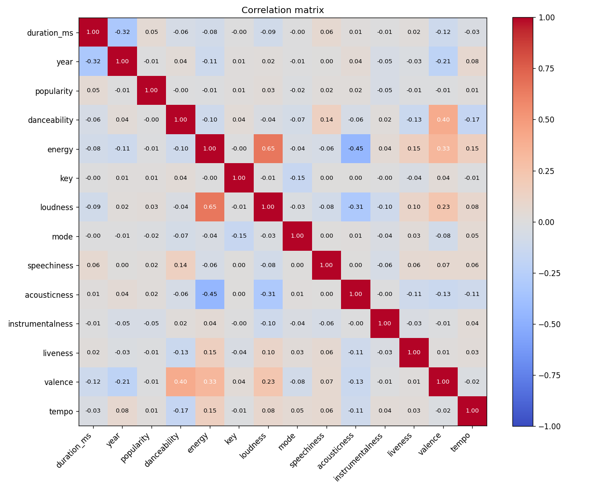
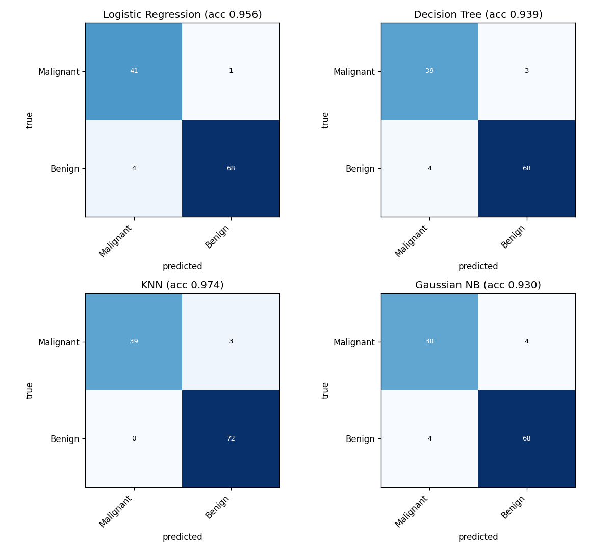
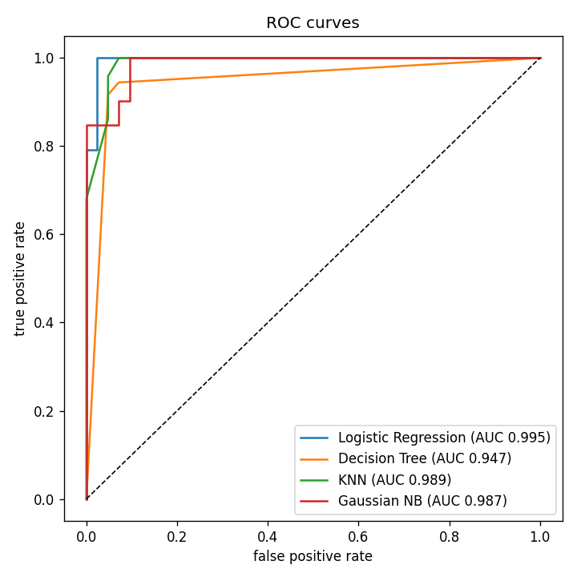
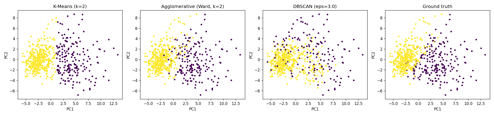
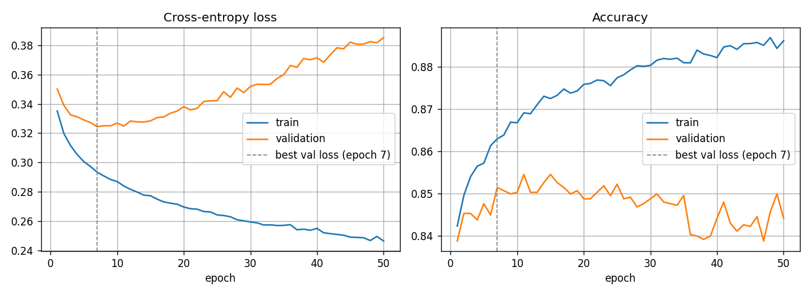

# Classical ML on Tabular Data

Five end-to-end experiments on public tabular datasets: exploratory analysis, regression, classification with
hyperparameter search, clustering and a PyTorch MLP compared against linear baselines. Every script is reproducible
from the command line and saves its metrics (JSON/CSV) and plots to [`results/`](results).

| Task | Dataset | Methods | Headline result |
|---|---|---|---|
| [EDA](#1-exploratory-analysis) | Spotify top hits 2000-2019 | pandas, IQR outliers, correlations | popularity barely correlates with any audio feature (abs r <= 0.05) |
| [Regression](#2-regression) | Spotify top hits | Linear, polynomial + RidgeCV, Ridge, Lasso | R² = 0.12 (Lasso), beats the mean baseline only modestly |
| [Classification](#3-classification) | Breast Cancer Wisconsin | LogReg, Decision Tree, KNN, Naive Bayes, GridSearchCV | KNN: 97.4% accuracy, ROC-AUC 0.989; LogReg: ROC-AUC 0.995 |
| [Clustering](#4-clustering) | Breast Cancer Wisconsin | K-Means, Ward, DBSCAN, PCA | Ward clustering recovers the diagnosis with ARI 0.75 |
| [Tabular MLP](#5-tabular-mlp) | UCI Adult income | PyTorch MLP, validation-based model selection | MLP 85.3% accuracy, on par with logistic regression (85.6%) |

## Results

### 1. Exploratory analysis

`python -m tabular_ml.eda` &mdash; 2,000 tracks, 59 duplicates removed, no missing values.

- Energy and loudness are strongly correlated (r = 0.65); acousticness is negatively correlated with both.
- Popularity has near-zero linear correlation with every numeric feature, which already hints that the
  regression task below is hard.
- Mean popularity 59.6, median 65; mean track length 3.8 minutes.



### 2. Regression

`python -m tabular_ml.regression` &mdash; target `popularity`, 13 numeric features + one-hot genres (71 features),
1,354 / 339 train/test rows after cleaning.

| Model | MAE | RMSE | R² |
|---|---:|---:|---:|
| Lasso (alpha = 0.01) | 7.83 | 10.68 | **0.124** |
| Ridge (alpha = 1) | 7.84 | 10.70 | 0.121 |
| Linear | 7.84 | 10.70 | 0.121 |
| Polynomial (deg = 2) + RidgeCV | 8.05 | 10.88 | 0.091 |
| Mean baseline | 8.87 | 11.44 | -0.005 |

Audio features explain only about 12% of the variance in popularity. Polynomial features do not help: an
unregularised degree-3 expansion (the first version of this experiment) produces 64,823 features for 1,354 rows
and fails completely (R² far below zero); with degree 2 on audio features only and a cross-validated Ridge penalty it
is stable but still worse than the plain linear model.

### 3. Classification

`python -m tabular_ml.classification` &mdash; 569 samples, 30 features, stratified 80/20 split, 5-fold grid search
on F1. Preprocessing (1-99% quantile clipping, median imputation, scaling) lives inside the pipeline, so it is fitted
on the training folds only.

| Model | Best params | CV F1 | Test accuracy | Precision | Recall | F1 | ROC-AUC |
|---|---|---:|---:|---:|---:|---:|---:|
| KNN | k = 7 | 0.976 ± 0.017 | **0.974** | 0.960 | 1.000 | **0.980** | 0.989 |
| Logistic Regression | C = 1 | **0.983 ± 0.009** | 0.956 | 0.986 | 0.944 | 0.965 | **0.995** |
| Decision Tree | depth 5 | 0.953 ± 0.024 | 0.939 | 0.958 | 0.944 | 0.951 | 0.947 |
| Gaussian NB | &mdash; | 0.948 ± 0.008 | 0.930 | 0.944 | 0.944 | 0.944 | 0.987 |

Positive class = benign. KNN has the best test accuracy, but the test set has only 114 samples (the gap to logistic
regression is two predictions), while logistic regression has the higher cross-validated F1 and ROC-AUC. For a
diagnostic setting the confusion matrices matter more than accuracy: logistic regression misses 1 malignant tumour,
KNN misses 3.

 

### 4. Clustering

`python -m tabular_ml.clustering` &mdash; the same 30 features without labels; the diagnosis is used only to score
the clusters.

| Method | Clusters | Noise points | Silhouette | ARI | NMI |
|---|---:|---:|---:|---:|---:|
| Agglomerative (Ward, k = 2) | 2 | 0 | 0.315 | **0.755** | **0.648** |
| K-Means (k = 2) | 2 | 0 | **0.344** | 0.659 | 0.540 |
| DBSCAN (eps = 3.0, min_samples = 5) | 1 | 148 | &mdash; | 0.143 | 0.082 |

k = 2 was chosen with the elbow and silhouette plots, eps from the k-distance graph. DBSCAN finds a single dense
core (303 benign + 118 malignant samples) and marks 148 points as noise, two thirds of them malignant. Other
eps/min_samples values do not produce two meaningful clusters either (best ARI tried: 0.23), so density-based
clustering is a poor fit for this data. For DBSCAN, noise is counted as its own label when computing ARI/NMI.



### 5. Tabular MLP

`python -m tabular_ml.tabular_mlp` &mdash; 32,561 people, 14 attributes one-hot encoded to 108 features, predicting
income > 50K. One hidden layer of 64 units, Adam (lr 1e-3), batch 256, 50 epochs. 10% of the training data is held
out for validation; the test set is only used for the final numbers.

| Model | Accuracy | F1 | ROC-AUC |
|---|---:|---:|---:|
| Majority class | 0.759 | &mdash; | &mdash; |
| Logistic Regression | **0.856** | **0.672** | 0.903 |
| MLP, weights from the best validation epoch (7) | 0.853 | 0.665 | **0.905** |
| MLP, after 50 epochs | 0.847 | 0.656 | 0.895 |

The MLP starts overfitting after about 7 epochs: training loss keeps falling while validation loss rises. Keeping
the best-validation weights recovers about 0.6 pp of accuracy, but the network still only matches logistic
regression &mdash; on one-hot encoded census data a small MLP has little to add over a linear model.



## Setup

```bash
python -m venv .venv
.venv\Scripts\activate          # Windows; source .venv/bin/activate on Linux/macOS
pip install -r requirements.txt
pytest
```

Data:

- **Breast Cancer Wisconsin** ships with scikit-learn, nothing to download.
- **UCI Adult** is read from `data/adult.csv` ([Kaggle version](https://www.kaggle.com/datasets/uciml/adult-census-income))
  or downloaded automatically from OpenML if the file is missing.
- **Spotify top hits** must be downloaded manually from
  [Kaggle](https://www.kaggle.com/datasets/paradisejoy/top-hits-spotify-from-20002019) and saved as
  `data/spotify_top_hits.csv`.

Each script accepts `--out` (and `--data` where a CSV is used), e.g.
`python -m tabular_ml.tabular_mlp --epochs 20 --out results/mlp_20`.

## Project structure

```
tabular_ml/
  data.py            dataset loaders
  plotting.py        shared matplotlib helpers
  eda.py             exploratory analysis
  regression.py      popularity regression
  classification.py  diagnosis classification + QuantileClipper transformer
  clustering.py      K-Means / Ward / DBSCAN
  tabular_mlp.py     PyTorch MLP vs baselines
tests/               unit and smoke tests (CPU, a few seconds)
results/             metrics and plots produced by the scripts
```
